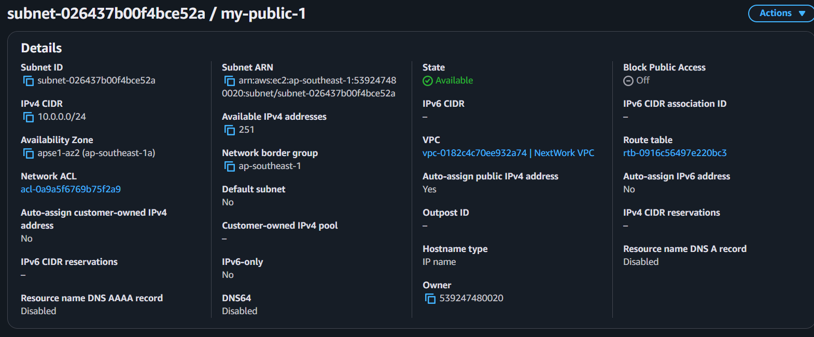
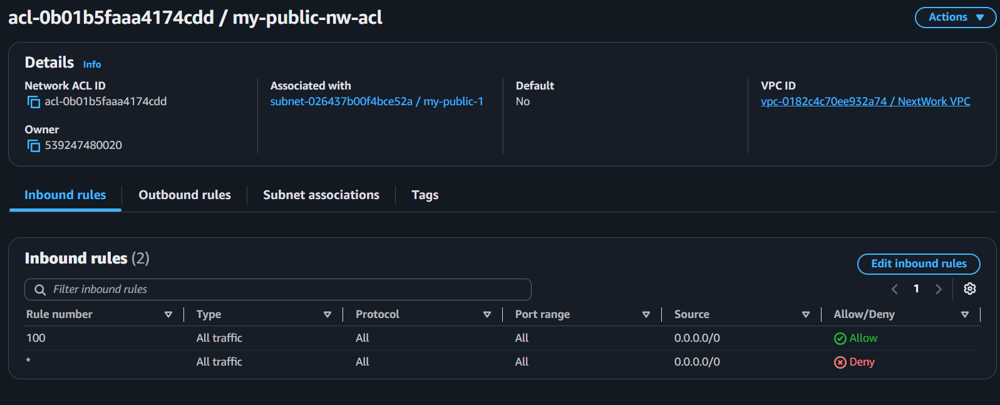
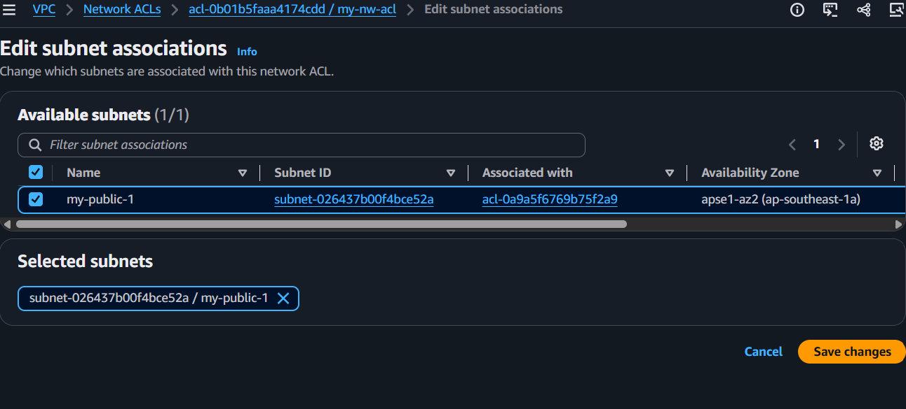
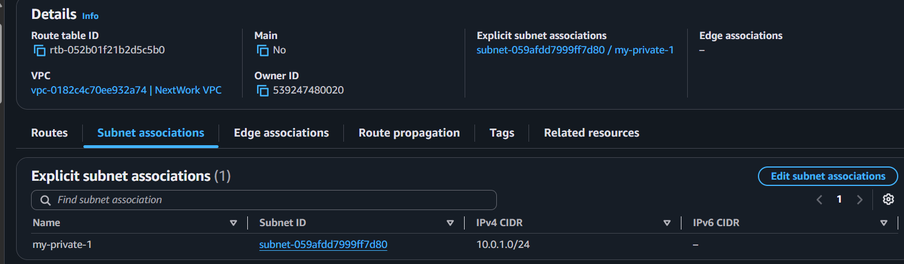
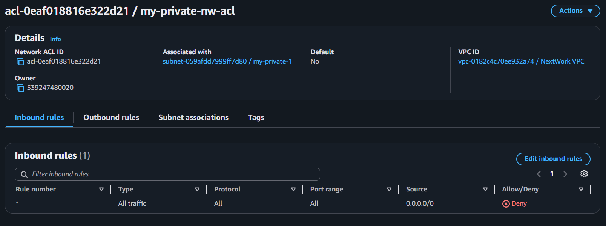
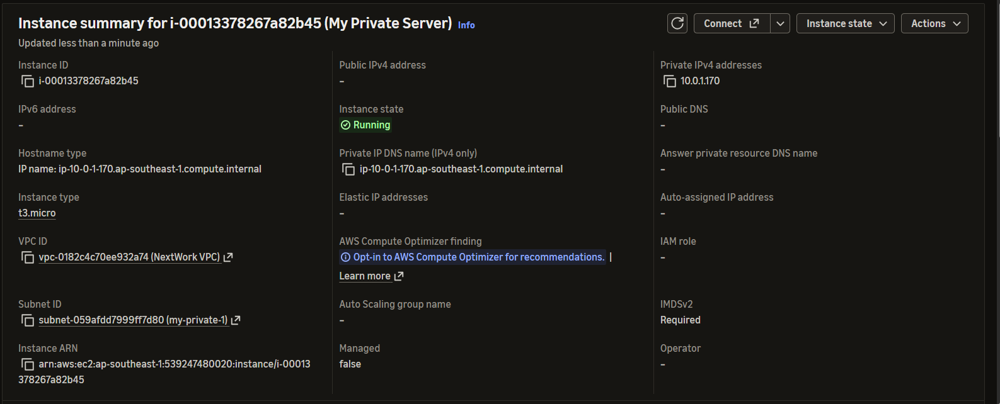
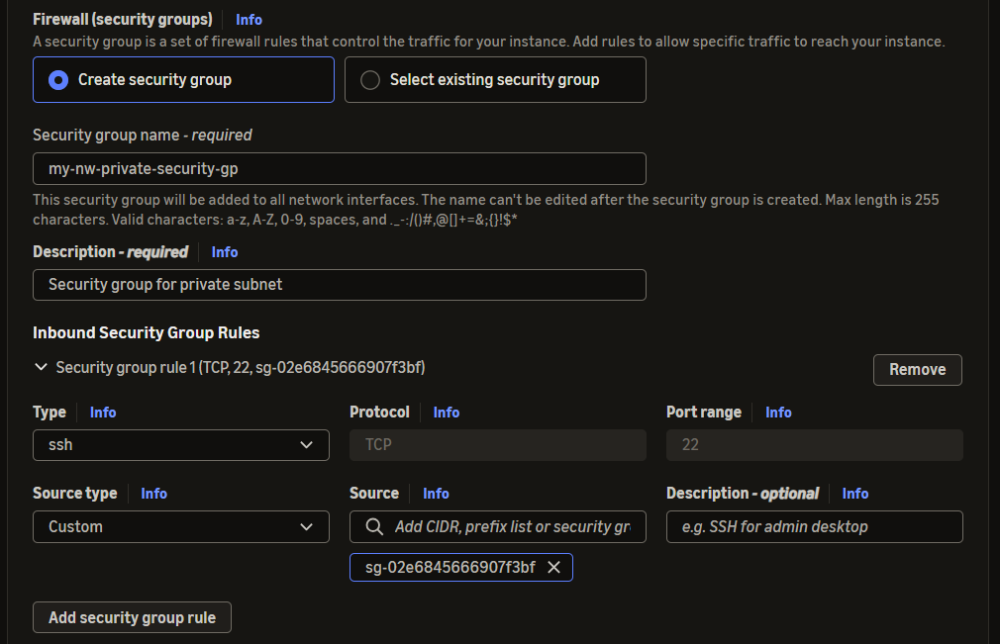

# ☁️ AWS VPC Networking Project

> A hands-on AWS project to learn virtual networking, IP addressing, and network routing.

## 🎯 Objectives

- Create and configure an **Amazon VPC and subnet**
- Understand **IPv4 and CIDR notation**
- Configure an **Internet Gateway and route table**
- Explore AWS networking through the **AWS Console and CLI**

## 🛠️ AWS Services & Tools

- Amazon VPC
- Subnets, Route Tables, Internet Gateway
- AWS Management Console

## 🏗️ Architecture

*Add an architecture diagram showing your VPC, subnet, Internet Gateway, and routing.*

## ⚙️ Implementation

### Step 1: Create a VPC

First, I created an Amazon VPC to establish an isolated virtual network for AWS resources.

- **CIDR Block:** `10.0.0.0/16`

---

### Step 2: Create a Subnet

After that, I created a subnet within the VPC to allocate a smaller IP address range to resources.

- **Subnet CIDR Block:** `10.0.0.0/24`
- **Availability Zone:** `apse1-az2 (ap-southeast-1a)`

---

### Step 3: Create an Internet Gateway

Then, I created an Internet Gateway and attached it to the VPC.

- **Purpose:** Provides a gateway for communication between the VPC and the internet.

---

### Step 4: Configure the Route Table

Here, I configured my public route table to control how network traffic is routed from the subnet.

- **Destination:** `my-new-igw`
- **Target:** `0.0.0.0/0`
- **Subnet Association:** `my-public-1`

**What I Learned Here is:** An Internet Gateway alone does not provide internet connectivity. The route table must direct the appropriate traffic to it, and additional network requirements must be satisfied.

---

### Step 5: Create a Security Group

Now, I created a security group to control inbound and outbound traffic for resources within my VPC.

- **Name:** `my-nw-security-gp`
- **Description:** A Security Group for the NextWork VPC.
- **VPC:** `NextWork VPC`

**Inbound Rule:**

| Type | Protocol | Port | Source |
|---|---|---|---|
| HTTP | TCP | 80 | `0.0.0.0/0` |

**Outbound Rules:** Default rule allowing all outbound traffic.

**Note Here:** I created only security group here. Yet I haven't used it to launch EC2, which I will do so later. 

---

### Step 6: Create a Network ACL (NACL)

Created a custom Network ACL to control inbound and outbound traffic at the subnet level.

- **Name:** `my-public-nw-acl`
- **VPC:** `NextWork VPC`

**Inbound Rules:**

| Rule Number | Type | Source | Action |
|---|---|---|---|
| 100 | All Traffic | `0.0.0.0/0` | Allow |

**Outbound Rules:**

| Rule Number | Type | Destination | Action |
|---|---|---|---|
| 100 | All Traffic | `0.0.0.0/0` | Allow |

**Subnet Association:**
- Associated with: `my-public-1`

---

### Step 7: Create a Private Subnet

Now, it's time to create a second subnet within the existing VPC to separate private resources from publicly accessible resources.

- **Name:** `my-private-1`
- **VPC:** `NextWork VPC`
- **IPv4 CIDR Block:** `10.0.1.0/24`
- **Availability Zone:** Second Availability Zone

**Similarily as above:** I have to associated my above private subnet to my newly created private route table "**private-nw-route-table**". 

Again, when I create a private subnet, there is also Network ACL created as default and already associated with that subnet, but I will create custom Network ACL **my-private-nw-acl**.

**Note:** The custom network ACLs start with denying all inbound and outbound traffic, but I will leave it for now, and will customize later. 

### Step 8: Launch instances in each subnet

After setting up the VPC as above, now it is ready to launch a **public server** and a **private server** in each subnet. 

✅ I created a separate **security group for the private server**, allowing inbound traffic only from the public subnet because internal communication is required, but outbound traffic to the private server is not.

## 🔧 Challenges & Solutions

- **Challenge:** *Describe an issue you encountered.*
- **Solution:** *Explain how you resolved it.*

## 🚀 Future Improvements

- Deploy an EC2 instance and test connectivity
- Build public and private subnets
- Explore VPC Flow Logs and network security
- Automate infrastructure using Terraform

## 📚 References

- [NextWork — Build a Virtual Private Cloud](https://nextwork.ai/projects/7f907ac7-2473-5c15-a8be-edb36581cdba?track=high)
- [Amazon VPC Documentation](https://docs.aws.amazon.com/vpc/latest/userguide/what-is-amazon-vpc.html)
